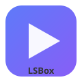

<div align="right">
  <a href="skill/SKILL.md">دۆرەت ئارخىپى (Project Rules)</a>
</div>

<div align="center">
  
  <br/>

# LSBox

**ئوچۇق كودلۇق سىن قويغۇچ / ۋىدېئو قويغۇچ**

[](https://github.com/Mr-losfer/lsbox/releases)
[](LICENSE)

</div>

---

## كىرىش سۆز

LSBox — بىر ئوچۇق كودلۇق سىن قويغۇچ رامكىسى. ئۇ پەقەت قويۇش ئارا يۈزى، مەنبە سەپلەمە باشقۇرۇشى ۋە يەرلىك قويۇش ئىقتىدارى بىلەن تەمىنلەيدۇ.

> **مۇھىم ئۇقتۇرۇش**: بۇ يۇمشاق دېتالنى چۈشۈرۈش، ئورنىتىش ياكى ئىشلىتىشتىن بۇرۇن، تۆۋەندىكى تولۇق مەزمۇننى ئەستايىدىل ئوقۇڭ. بۇ يۇمشاق دېتالنى چۈشۈرۈش، ئورنىتىش ياكى ئىشلىتىش ئارقىلىق، سىز تۆۋەندىكى بارلىق ماددىلارنى ئوقۇپ چۈشەنگەنلىكىڭىز ھەمدە قوبۇل قىلغانلىقىڭىزنى بىلدۈرىسىز.

## ئالاھىدىلىكلەر

- ئوچۇق كودلۇق سىن قويغۇچ رامكىسى
- كۆپ خىل تىل قوللىشى: ئۇيغۇرچە، قازاقچە، خەنزۇچە، ئىنگلىزچە ۋە باشقا تىللار
- ئۇيغۇرچە خەت نۇسخىسى تاللاش (كۆنۈپ قالغان UKIJ Tuz، جەمئىي 10 خىل خەت نۇسخىسى)
- تۇنجى قېتىم ئېچىلغاندا تىل تاللاش يېتەكچىسى (Apple hello ئۇسلۇبى)
- ئاپتوماتىك يېڭىلاش ئىقتىدارى (gh-proxy.com ۋاكالىتىنى ئالدىن ئىشلىتىش، مەسىلە بولسا بىۋاسىتە ئۇلىنىش)
- TMDB ئۇچۇرلىرىنى قوللاش
- كۆپ خىل مەنبە سەپلەش ۋە باشقۇرۇش
- بىۋاسىتە كۆرسىتىش، ناخشا قويۇش، خەت (سوبتېتر)، لەيلىمە خەت قاتارلىق ئىقتىدارلار

## چۈشۈرۈش

[نەشر بېتى](https://github.com/Mr-losfer/lsbox/releases) دىن ئەڭ يېڭى نەشرنى چۈشۈرۈڭ:

- **Android APK**: `LSBox_v1.5.0_arm64-v8a.apk`
- **كومپيۇتېر نەشرى (Windows)**: `LSBox_v1.5.0_win-x64.zip`

## تىل تاللاش

بۇ يۇمشاق دېتال تۇنجى قېتىم ئېچىلغاندا، Apple hello ئۇسلۇبىدىكى كۆپ تىللىق سالاملىشىش بېتى كۆرسىتىلىدۇ. ئۆزىڭىز ياقتۇرغان تىلنى تاللىسىڭىز بولىدۇ:

- ئۇيغۇرچە (ئۇيغۇر تىلى)
- قازاقچە (شىنجاڭ قازاق تىلى)
- خەنزۇچە (ئاددىيلاشقان)
- English
- مۇرەببەت خەنزۇچە (تەيۋەن / شياڭگاڭ)

كېيىنچە تىلنى «تەڭشەك → تىل» دىن ئالماشتۇرالايسىز.

## ئۇيغۇرچە خەت نۇسخىسى

«تەڭشەك → خەت نۇسخىسى تەڭشىكى» دىن ئۆزىڭىز ياقتۇرغان ئۇيغۇرچە خەت نۇسخىسىنى تاللىيالايسىز:

| خەت نۇسخىسى | چۈشەندۈرۈش |
|---|---|
| **UKIJ Tuz** (كۆنۈپ قالغان) | UKIJ ئۆلچەملىك خەت نۇسخىسى |
| UKIJ Tuz K / G / Q | UKIJ Tuz نىڭ ھەر خىل ئۆزگىرىشلىرى |
| UKIJ Basma | UKIJ باسما خەت نۇسخىسى |
| ALKATIP Asliya / Basma / Kitab / Tor | ALKATIP كونا خەت نۇسخىلىرى |
| Alpsoft Basma | Alpsoft زامانىۋى خەت نۇسخىسى |

بۇ خەت نۇسخىلىرى LOSFER ئۇيغۇرچە خەت نۇسخىلىرى ئامبىرىدىن ئېلىنغان. خەت نۇسخىسى ھوقۇقى ئەسلى ئاپتورلارغا تەۋە، پەقەت ئۆگىنىش ۋە پىكىر ئالماشتۇرۇش ئۈچۈنلا.

## ئاپتوماتىك يېڭىلاش

بۇ يۇمشاق دېتال ھەر قېتىم ئېچىلغاندا، [Mr-losfer/lsbox](https://github.com/Mr-losfer/lsbox) ئامبىرىدىكى ئەڭ يېڭى نەشرنى ئاپتوماتىك تەكشۈرىدۇ. يېڭى نەشر بايقالغاندا، نەشر ئۇچۇرى كۆرسىتىلگەن سۆزلەشكۈ چىقىدۇ. «ھازىر يېڭىلاش» نى باسسىڭىز، يۇمشاق دېتال ئىچىدە چۈشۈرۈلۈپ ئورنىتىلىدۇ.

**تور ۋاكالەتچىسى**: چۈشۈرۈش، تەكشۈرۈش ۋە git مەشغۇلاتلىرى ئالدى بىلەن `gh-proxy.com` ۋاكالىتى ئارقىلىق ئېلىپ بېرىلىدۇ. ۋاكالىتىدە مەسىلە كۆرۈلسە، ئاپتوماتىك ھالدا بىۋاسىتە ئۇلىنىشقا ئالمىشىدۇ.

## قۇرۇلۇش

```bash
# Android APK
./gradlew assembleRelease

# نەتجىجە: app/build/outputs/apk/release/LSBox_release.apk
```

## ھوقۇق ۋە مەسئۇلىيەت

1. بۇ يۇمشاق دېتال **GNU Affero General Public License v3.0 (AGPL-3.0)** ئوچۇق كود لائىسەسى بويىچە تارقىتىلىدۇ.
2. بۇ يۇمشاق دېتال تۆۋەندىكى ئەسلى تۈرلەر ئاساسىدا ئېچىلغان، ئالاقىدار ھوقۇقلار ئەسلى ئاپتورلارغا تەۋە:
   - [TVBoxOS](https://github.com/q215613905/TVBoxOS)
   - [TVBoxOSC](https://github.com/CatVodTVOfficial/TVBoxOSC)
   - [AVBox](https://github.com/XiaochangXu/AVBox) (XiaochangXu)
3. بۇ يۇمشاق دېتالنى ئىككىنچى قېتىم ئېچىش ياكى تارقىتىشتا، AGPL-3.0 لائىسە ماددىلىرىغا ئەمەل قىلىشى، ئەسلى ھوقۇق ئىزھارى ۋە مەنبە ئۇلىنىشىنى ساقلىشى، ھەمدە ئوخشاش لائىسە بويىچە تارقىتىشى كېرەك.
4. بۇ يۇمشاق دېتالنىڭ ئىسمى، Logo ۋە ئالاقىدار بەلگىلىرى تۈر ئېچىغۇچىلارغا تەۋە.

## خاتىرە (ئاپتور)

- **ئاپتور**: Mr-losfer
- **ئەسلى تۈر ئاپتورلىرى**: XiaochangXu (AVBox)، CatVodTVOfficial (TVBoxOSC)، q215613905 (TVBoxOS)
- **ئامبار**: [github.com/Mr-losfer/lsbox](https://github.com/Mr-losfer/lsbox)

## ئۇقتۇرۇش ۋە ئۆچۈرۈش (ھوقۇق ئىگىلىرىنىڭ ئەرزى)

1. ئەگەر سىز مەلۇم مەزمۇننىڭ ھوقۇق ئىگىسى بولسىڭىز، ئابونتلارنىڭ بۇ يۇمشاق دېتال ئارقىلىق زىيارەت قىلغان مەزمۇن سىزنىڭ قانۇنىي ھوقۇقىڭىزغا دەخلى يەتكۈزگەن دەپ قارىسىڭىز، تۆۋەندىكى ئۇسۇللار ئارقىلىق ئېچىغۇچى بىلەن ئالاقىلىشىڭ:
   - GitHub Issue (بەلگە `[ھوقۇق ئەرزى]`) يوللاش
   - ياكى تۈر بېتىدە ئېلان قىلىنغان ئالاقە ئۇسۇلى ئارقىلىق
2. ئەرز سۇنغاندا: ھوقۇق ئىگىسى سالاھىيەت ئىسپاتى، دەخلى يەتكەن مەزمۇن ئۇلىنىشى ياكى مەنبە ئادرېسى، ھوقۇق ئىسپاتى، ئالاقە ئۇسۇلى ۋە ھەقىقىيلىققا كاپالەتنى تەمىنلەش كېرەك.

## شەخسىيەت ۋە سانلىق مەلۇمات

1. بۇ يۇمشاق دېتال ئابونتلارنىڭ شەخسىي سالاھىيەت ئۇچۇرىنى يىغمايدۇ. قويۇش تارىخى، مەنبە سەپلەمىسى، كۆرۈش خاتىرىسى قاتارلىق سانلىق مەلۇماتلار پەقەت ئابونتنىڭ يەرلىك ئۈسكۈنىسىدە ساقلىنىدۇ.
2. بۇ يۇمشاق دېتال ھېچقانداق ئابونت سانلىق مەلۇمات يىغىش، ئىز قوغلاش ياكى ئېلان SDK سى ئىشلەتمەيدۇ.

---

<div align="center">
  <sub>LSBox — Mr-losfer تەرىپىدىن ئېچىلغان | AGPL-3.0</sub>
</div>
